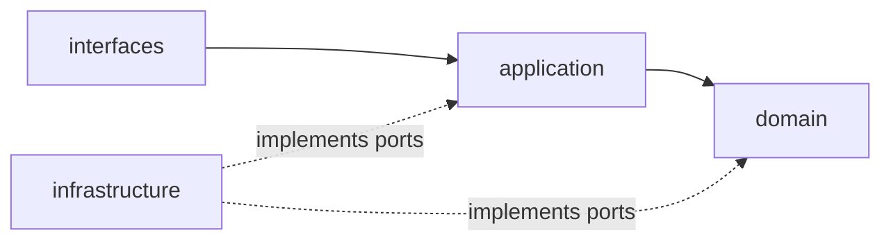
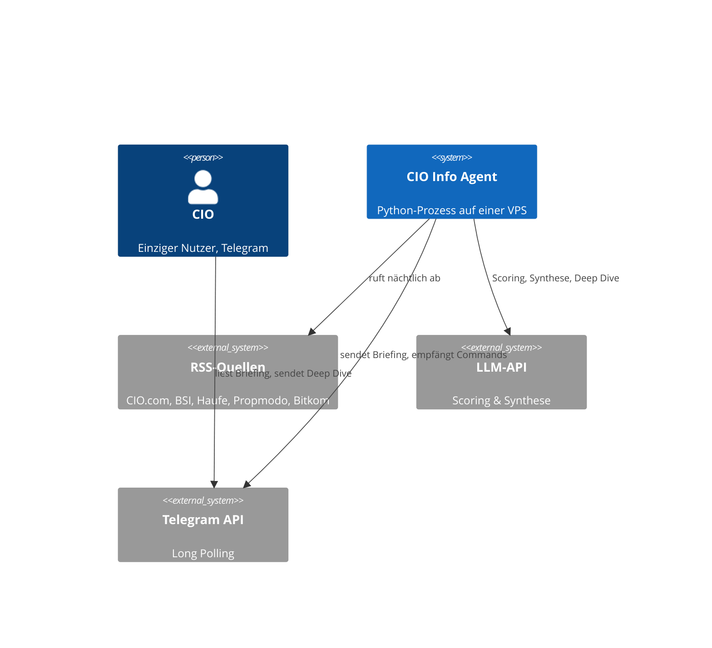
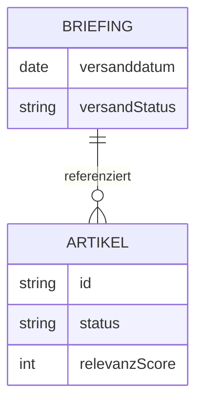

# Architecture Spine — CIO Info Agent (Real Estate Edition)

## Design Paradigm

Layered, DDD-orientiert: `domain` (Artikel, Briefing, Value Objects, Invarianten) →
`application` (Use-Case-Orchestrierung) → `infrastructure` (RSS, LLM, Telegram, Persistenz)
/ `interfaces` (Telegram-Command-Handling). Übernommen `[ADOPTED]` aus Dominos
validiertem Domänenmodell und den projektweiten DDD-Prinzipien — nicht neu verhandelt.

## Invariants & Rules



### AD-1 — Abhängigkeitsrichtung `[ADOPTED]`

- **Binds:** alle Schichten
- **Prevents:** Domäne, die von Infrastruktur oder Framework abhängt
- **Rule:** `domain` hat keine Abhängigkeit nach außen. `interfaces` ruft ausschließlich
  `application` auf. `infrastructure` implementiert von `domain`/`application`
  definierte Port-Interfaces — nie umgekehrt.

### AD-2 — Aggregate-Eigentümerschaft `[ADOPTED]`

- **Binds:** FR-1–FR-9
- **Prevents:** `Briefing`, das direkt innere Zustände von `Artikel` mutiert
- **Rule:** `Artikel` und `Briefing` sind zwei getrennte Aggregate Roots mit eigenem
  Lebenszyklus. `Briefing` referenziert `Artikel` ausschließlich über dessen ID, nie
  über direkte Objektreferenz oder Mutation.

### AD-3 — Laufzeit & Sprache

- **Binds:** gesamtes System
- **Prevents:** uneinheitliche Toolchain zwischen Ingestion, Scoring, Zustellung
- **Rule:** Python 3.15 ist die einzige Implementierungssprache. Begründung: reife
  Bibliotheken für genau diesen Anwendungsfall (RSS, Telegram, Scheduling, LLM-SDKs)
  und geringere Betriebskomplexität für Einzelentwickler-Betrieb.

### AD-4 — Telegram-Interaktionsmodell

- **Binds:** FR-6, FR-7, FR-8, FR-9, FR-10
- **Prevents:** Notwendigkeit eines öffentlich erreichbaren HTTPS-Endpunkts/Webhooks
- **Rule:** Der Bot verwendet ausschließlich **Long Polling**, keinen Webhook. Das
  gesamte System ist nach außen nur als ausgehende Verbindung sichtbar, nie als
  eingehender öffentlicher Endpunkt.

### AD-5 — Deployment-Modell

- **Binds:** gesamtes System
- **Prevents:** verteilte Multi-Service-Topologie mit eigenständigen Fehlermodi
- **Rule:** Ein einzelner, durchgehend laufender Host (z. B. Hetzner CX22-Klasse,
  ~5 €/Monat) trägt sowohl den nächtlichen Batch-Lauf (Cron/Scheduler-Prozess) als auch
  den Long-Polling-Listener als einen gemeinsam deploybaren Python-Prozessverbund.
  Serverless-Aufteilung wurde bewusst verworfen (Rule of Three before abstraction) —
  ein zweites Deployment-Modell existiert nicht, bevor Lastdaten einen Bedarf zeigen.

### AD-6 — LLM-Anbindung als Port

- **Binds:** FR-3, FR-8
- **Prevents:** LLM-Provider-Spezifika, die in Domäne oder Application-Schicht sickern
- **Rule:** Scoring und Deep-Dive-Zusammenfassung laufen ausschließlich über ein
  `LLMPort`-Interface in `application/ports/`; `infrastructure/llm/` liefert die
  konkrete Adapter-Implementierung. Default-Empfehlung: ein kosteneffizientes
  Small-Tier-Modell (vergleichbar GPT-5.6 Luna, ~0,20 $/1,20 $ je Mio. Token) — frei
  austauschbar ohne Eingriff in Domäne oder Application.

### AD-7 — Persistenz

- **Binds:** FR-2, FR-4, FR-5, FR-6, FR-7
- **Prevents:** Notwendigkeit eines separaten verwalteten Datenbank-Dienstes; inkompatible
  Annahmen über gleichzeitigen Zugriff zwischen Batch-Prozess und Listener-Prozess
- **Rule:** Eingebettetes SQLite trägt `Artikel`-, `Briefing`- und Dedup-Zustand.
  Repository-Interfaces liegen in `domain`/`application`; die SQLite-Implementierung
  liegt ausschließlich in `infrastructure/persistence/`. Da der nächtliche Batch-Lauf
  (AD-5) und der Long-Polling-Listener (AD-4) als getrennte Prozesse auf demselben Host
  gleichzeitig auf dieselbe SQLite-Datei zugreifen können, läuft SQLite im
  **WAL-Modus** (`PRAGMA journal_mode=WAL`), und jeder Zugriff geht über kurze,
  abgeschlossene Transaktionen — kein Prozess hält eine Schreibverbindung offen über
  mehrere Schritte hinweg.

### AD-8 — Secrets-Handling

- **Binds:** FR-10, Guardrails (Security)
- **Prevents:** Telegram-Token/LLM-API-Key im Quellcode oder in Logs
- **Rule:** Telegram-Bot-Token und LLM-API-Key werden ausschließlich über
  Umgebungsvariablen / einen host-seitigen Secret-Store bereitgestellt — niemals
  committed, niemals geloggt.

## Consistency Conventions

| Concern | Convention |
| --- | --- |
| Naming (Module, Klassen, Events) | Deutsche Ubiquitous-Language-Begriffe als Klassennamen (`Artikel`, `Briefing`, `RelevanzScore`); `snake_case` für Python-Module/-Funktionen, `PascalCase` für Klassen, Domain Events als Partizip Perfekt (`ArtikelBewertet`) |
| Sprache im Code (ergänzt 2026-10-24, Review-Runde Story 1.1) | Code-Kommentare, Docstrings und interne/Ops-seitige Fehler-/Logmeldungen: **Englisch** (deutsche Domänen-Begriffe bleiben als Bezeichner erlaubt). Nutzerseitiger Text, der an den CIO geht (Briefing, Deep-Dive-Antworten, Leer-Nachricht): **Deutsch**. |
| Daten & Formate | IDs: deterministisch aus (Quelle, Link) abgeleiteter Hash; Zeitstempel intern UTC (ISO 8601), Zustellzeitpunkt (07:00) in `Europe/Berlin` `[ASSUMPTION: Zeitzone nicht explizit im PRD, aus deutschsprachigen Quellen abgeleitet]`; Fehler als Unterklassen von `DomainException` |
| State & Cross-Cutting | Mutation nur über Aggregate-Root-Methoden; strukturiertes Logging (JSON Lines) ohne personenbezogene/sensible Daten; Konfiguration über Umgebungsvariablen; Zugriffskontrolle (Chat-ID-Whitelist) wird in `interfaces/` vor jedem Command-Dispatch geprüft |

## Stack

| Name | Version |
| --- | --- |
| Python | 3.15.1 |
| python-telegram-bot | 22.8 |
| feedparser | 6.0.14 |
| APScheduler | 3.11.3 (stabile 3.x-Linie) |
| SQLite | eingebettet (Python-Standardbibliothek `sqlite3`) |
| LLM-SDK | offizielles SDK des gewählten Providers (z. B. `openai` für GPT-5.6-Luna-Klasse) |

## Structural Seed





```text
cio_info_agent/
  domain/
    artikel/        # Artikel (Aggregate Root), ArtikelStatus, RelevanzScore, Exceptions
    briefing/        # Briefing (Aggregate Root), Kategorie
    shared/          # Quelle (VO), ChatId (VO)
  application/
    services/        # Ingestion-, Scoring-, Synthese-, Zustellungs-, DeepDive-Orchestrierung
    ports/           # ArtikelRepository, BriefingRepository, LLMPort, TelegramPort, FeedPort
  infrastructure/
    persistence/      # SQLite-Implementierungen der Repository-Ports
    llm/              # LLMPort-Adapter für den gewählten Provider
    telegram/         # Long-Polling-Adapter (TelegramPort)
    feeds/            # feedparser-basierter FeedPort-Adapter
    scheduler/        # APScheduler-Verdrahtung für den nächtlichen Lauf
  interfaces/
    telegram_bot/     # Command-Handler (Deep Dive), Whitelist-Prüfung vor Dispatch
```

## Capability → Architecture Map

| Capability / Area | Lives in | Governed by |
| --- | --- | --- |
| FR-1 (Feed-Abruf) | `infrastructure/feeds/`, `application/services/` | AD-6 (Port), Stack (feedparser) |
| FR-2 (Dedup) | `domain/artikel/`, `infrastructure/persistence/` | AD-2, AD-7 |
| FR-3, FR-4 (Scoring & Filterung) | `domain/artikel/`, `application/services/`, `infrastructure/llm/` | AD-6 |
| FR-5 (Synthese) | `domain/briefing/`, `application/services/` | AD-1, AD-2 |
| FR-6, FR-7 (Zustellung) | `application/services/`, `infrastructure/telegram/`, `infrastructure/scheduler/` | AD-4, AD-5 |
| FR-8, FR-9 (Deep Dive) | `interfaces/telegram_bot/`, `application/services/`, `infrastructure/llm/` | AD-4, AD-6 |
| FR-10 (Whitelisting) | `interfaces/telegram_bot/` | AD-8 |

## Deferred

- **Audit-/Historisierungs-Speicherung verworfener Artikel** — PRD-Open-Question;
  zurückgestellt bis Nutzungserfahrung zeigt, ob das gebraucht wird.
- **Feiertagslogik bei der Zustellung** — PRD-Open-Question; MVP liefert Mo–Fr ohne
  Feiertagsausnahme.
- **Monitoring/Alerting bei wiederholten Feed-Ausfällen** — kein AD fixiert; erste
  Iteration nutzt Standard-Logging, dediziertes Alerting folgt nach Betriebserfahrung.
- **Manueller Refresh-Befehl / Abruf vergangener Briefings** — v2-Kandidaten, nicht
  Teil dieser Spine.
- **Mehrbenutzerfähigkeit** — bewusst dauerhaft nicht geplant (Brief-Entscheidung),
  kein Architektur-Pfad dafür vorgesehen.
- **Tie-Breaking bei Score-Gleichstand (R8)** — in Domino's Domänenmodell bereits als
  Geschäftsregel entschieden (neuester Artikel gewinnt); hier nicht erneut fixiert.
